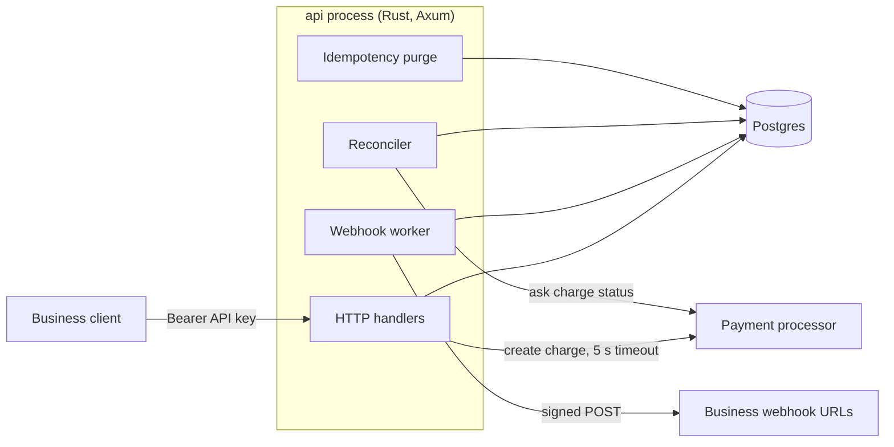
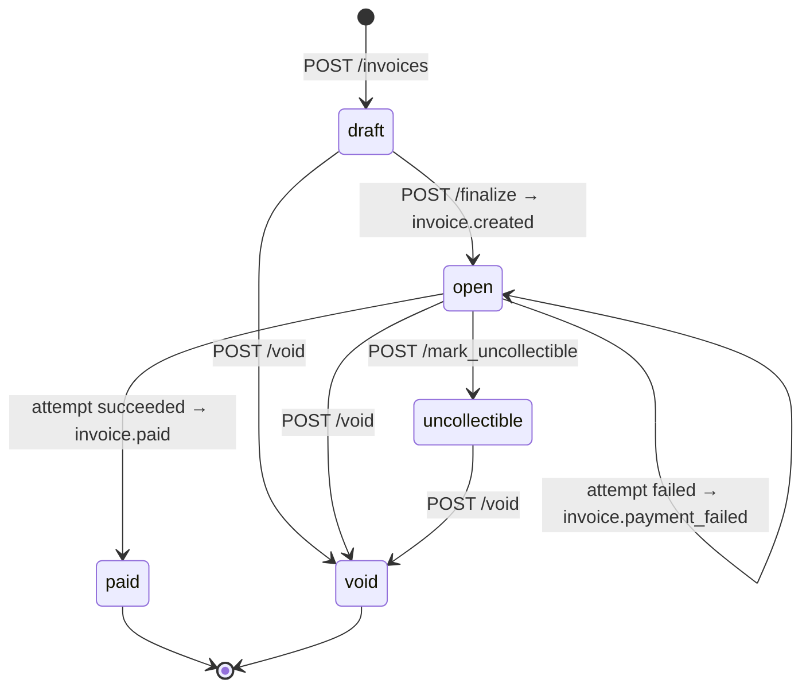

# DESIGN — Invoice & Payment Service

## 0. Architecture

**Why this shape:**
- **Postgres is the only stateful component, and it holds every guarantee.** No double charge, valid transitions and reliable webhooks all come from constraints and transactions, so correctness never depends on two systems staying in sync.
- **Requests only change state; side effects run later.** A request runs one short conditional transaction that also writes its outbox rows. Webhook delivery and settling unknown payments happen in background tasks, so the API never waits on a receiver.
- **Background tasks are stateless pollers inside the API process.** They lease rows from Postgres, so they can move into separate processes without a protocol change.
- **Card charging is delegated to a payment processor (PSP).** We never hold card data, only a token; the PSP moves the money. That makes it the one dependency outside our control that can be slow, fail, or succeed without us hearing back, so the payment design is built around it. It assumes three things, and any PSP with idempotency keys and charge lookup provides them:
  1. **It deduplicates on our reference** (`attempt_id`), so a retried call can't charge twice.
  2. **It can report a charge's status by that reference**, so an unknown outcome can be settled later instead of guessed.
  3. **It answers "not found" only for charges it never received**, so those can safely be failed.
- **Plain SQL (sqlx), not an ORM:** the conditional `UPDATE`s that carry the money guarantees stay visible in review.

## 1. Data Model

- **Primary keys:** app-generated UUIDv7. They're time-ordered, so inserts append to the B-tree and `id` works as a keyset-pagination cursor, and they can't be enumerated.
- **Tenancy:** `business_id` is on every table. Tenant-facing indexes lead with it, and it's the future shard key.
- **Money:** `bigint` cents, checked arithmetic, no floats anywhere.

| Table | Key columns | Indexes / constraints | Why |
|---|---|---|---|
| api_keys | prefix, key_hash, revoked_at | unique(prefix) | Several active keys per business allow rotation |
| customers | name, email | unique(business_id, email) | The same person can be a customer of many businesses |
| invoices | status, total_cents, due_date, **version** | FK (business_id, customer_id); (business_id, status, id) | The FK blocks cross-tenant invoices; `version` drives the CAS |
| invoice_line_items | quantity, unit_amount_cents, amount_cents | CHECK `amount_cents = quantity * unit_amount_cents` | Postgres re-checks the money math |
| payment_attempts | amount_cents, status, psp_ref, next_reconcile_at | **unique(invoice_id) WHERE succeeded**; **… WHERE pending** | The DB itself forbids double charges and parallel attempts |
| idempotency_keys | PK(business_id, key), request_hash, response | (expires_at) | One mechanism for every POST, with exact replay |
| webhook_endpoints | url, secret, enabled | (business_id) WHERE enabled | The HMAC needs a readable secret |
| events | type, invoice_id, payload | (business_id, id) | Append-only feed for reconciliation |
| webhook_deliveries | event_id, endpoint_id, status, next_attempt_at | (next_attempt_at) WHERE pending | Retries are tracked per endpoint |

**Rejected alternative:** idempotency columns on `payment_attempts` instead of a table. It's simpler, but it only covers `/pay`, can't replay errors that create no row, and rebuilds responses instead of storing them.

**At 100x:**
- Fold line items into `jsonb` on `invoices`: they're written once and always read with the invoice.
- Partition events, deliveries, attempts and idempotency keys by month, and drop old partitions.
- Throttle `last_used_at` writes.
- Run the worker and reconciler as separate processes, add read replicas for list endpoints, and shard by `business_id`.

## 2. Invoice State Machine

- **Terminal:** `paid` and `void`. **Reversible:** nothing. `uncollectible → paid` is excluded on purpose, because collecting after a write-off belongs with dunning, which is cut.
- **`invoice.created` fires on finalize,** because a draft isn't visible to the customer and can't be paid.
- **A decline leaves the invoice `open`.** Failure describes the attempt, not the invoice, so the customer can try another card.
- **Overdue is derived** (`open AND due_date < now()`), not a stored state.
- **Invalid transitions** return `409 invalid_state_transition {from, action}`. Every write is also a version CAS (§3), so a concurrent change is caught.
- **A pending attempt blocks void and write-off** (`409 payment_in_progress`), so the PSP can never charge a voided invoice.

## 3. Payment Correctness & Failure Modes

**Mechanism:** optimistic concurrency, a compare-and-swap on `invoices.version`, with partial unique indexes as the backstop. `/pay` requires an `Idempotency-Key`.

1. **Tx1 (milliseconds):** claim the key; require `open` with no pending attempt; run `UPDATE invoices SET version=version+1 WHERE id=$1 AND version=$v`; insert a `pending` attempt; commit.
2. **PSP call** with `reference = attempt_id` and a 5 s timeout. No transaction is open.
3. **Tx2, `finish_attempt()`:** update the attempt `WHERE status='pending'`, set the invoice to `paid` `WHERE status='open'`, write the outbox rows and store the response.

The endpoint returns **201** for a charge, **402** for a decline and **202** when the outcome is unknown.

**Why not the alternatives:**
- `FOR UPDATE` queues the losers, and holding it across the PSP call pins a connection.
- Advisory locks aren't tied to rows.
- SERIALIZABLE needs retry loops everywhere.

The CAS holds nothing while the PSP is slow, and losers fail fast.

**(a) Simultaneous `/pay`.** One CAS wins. The rest get **409 `concurrent_modification`**, which isn't stored, so a retry with the same key is allowed. Later arrivals get `payment_in_progress` or `invoice_already_paid`.

**(b) PSP timeout.**
- **Response:** after 5 s the API returns **202** with the attempt **still `pending`**. It isn't marked `failed`, because the PSP may still charge, and marking it failed would let the customer pay twice. The invoice stays `open`, and new attempts and voids get 409.
- **Reconciler:** every 5 s it asks the PSP for the status of attempts that have been pending for more than 10 s. Startup asserts that this age exceeds the PSP timeout, so it never races an in-flight request.
  - `succeeded` / `failed`: it runs `finish_attempt()`. Only one path can still find the attempt `pending`, so no lock is needed.
  - `processing` / PSP unreachable: it checks again later via `next_reconcile_at`. After 15 min it logs an error for a human. It never auto-fails, because money may have moved.
  - `not found`: the PSP never received the charge (e.g. the connection dropped before the request arrived), so the attempt fails and the invoice stays payable. In production I'd also wait out the PSP's idempotency window before treating this as final.
- **The caller finds out** from the webhook or `GET /invoices/{id}`. A same-key retry gets 409 `request_in_progress`, then the stored outcome.

**(c) PSP succeeds, then we crash before Tx2.** The attempt stays `pending`. Within about 15 s the reconciler sees `succeeded` and runs the same `finish_attempt()`: the invoice becomes paid, the webhook is emitted and the response is stored. A same-key retry gets 409, then a replay of the 201. A new key gets `payment_in_progress`, then `invoice_already_paid`. The PSP is never called twice: the pending attempt blocks new ones, the PSP deduplicates on `reference`, and `unique(invoice_id) WHERE succeeded` forbids a second success.

**(d) Same key, different body.** `request_hash` (SHA-256 of method, path and canonical JSON body) differs, so the API returns **422 `idempotency_key_reuse`** and executes nothing.

**(e) `/pay` on a paid invoice.** **409 `invoice_already_paid`**, with no PSP call. It's stored and replayed, because `paid` is terminal. Errors that can still change (`invalid_state_transition`, the transient 409s) aren't stored.

**Idempotency TTL.** Keys expire after 24 h, and an hourly task purges them in batches. After a purge, a late duplicate still hits the domain invariants: the paid check plus the unique-succeeded index, the unique customer email, or at worst an unpayable draft invoice. **The key is a retry convenience; the invariants are the money guarantee.**

## 4. Webhook Design

- **Transactional outbox.** The `events` row and one `webhook_deliveries` row per enabled endpoint commit in the same transaction as the state change. A worker polls every second, leases due rows (`FOR UPDATE SKIP LOCKED`, pushing `next_attempt_at` 60 s ahead) and sends them outside any transaction. If it crashes, the lease expires and the delivery is retried.
- **Why no message queue:** publishing to a queue after commit is a dual write that can lose events, so an outbox would be needed anyway. Postgres alone is enough at this scale.
- **Signing:** `Webhook-Signature: t=<unix>,v1=<hex HMAC-SHA256(secret, "{t}.{raw_body}")>` and `Webhook-Id: <event_id>`. Receivers compare in constant time, reject `|now−t| > 300 s` (replay protection) and dedupe on `Webhook-Id`, because delivery is at-least-once.
- **Retries:** 7 attempts: immediately, then after 10 s, 1 m, 5 m, 30 m, 2 h and 6 h (±20% jitter), about **8.6 h** in total. Each attempt has a 5 s timeout, and only a 2xx counts as delivered.
- **Exhausted deliveries** are marked `failed` and logged ("would email business"). The event is kept. Disabling an endpoint fails its pending deliveries.
- **Reconciliation:** businesses page through `GET /v1/events?cursor=` from their last processed id.
- **Secrets** are stored in plaintext, because the HMAC needs the raw value. Production would use KMS envelope encryption.

## 5. API Key Model

- **Generation:** `dodo_<8-char prefix>_<32 base62>` from the OS CSPRNG, about 190 bits. The prefix is a loggable lookup id, and the `dodo_` marker lets secret scanners match leaked keys.
- **Storage:** the prefix plus `SHA-256(key)`. Slow hashes protect low-entropy passwords; a 190-bit random key can't be brute-forced, so bcrypt would only add latency to every request.
- **Transmission:** `Authorization: Bearer` over TLS, never in URLs. Only the prefix is logged.
- **Rotation:** `POST /v1/api_keys` shows a new key once, and several keys can be active. Deploy the new key, wait for the old key's `last_used_at` to go quiet, then revoke it.
- **Revocation:** `DELETE /v1/api_keys/{id}` sets `revoked_at` and keeps the row for audit. Nothing is cached, so the next request gets 401.
- **Blast radius:** full access to one business: create invoices, charge tokens, register an endpoint that siphons events. Other tenants are unaffected. Scopes and expiry would narrow it.

## 6. What I Cut and Why

1. **Message queue and DLQ.** The outbox replaces them (§4).
2. **`overdue` status and dunning.** They need a scheduler and email; overdue is derivable.
3. **Alerting on, and auto-disabling, failing endpoints.** Logged only today.
4. **Webhook secret encryption and rotation.** They need key management that this scope doesn't justify.
5. **SSRF protection for webhook URLs.** Production would reject private and link-local IPs after DNS resolution, pin the resolved IP and send through an egress proxy.

**Refunds and partial payments** would be a `refunds` table referencing the succeeded attempt, not new invoice states.

## 7. Production Readiness Gap

1. **Observability.** Metrics and alerts on the oldest pending attempt, webhook backlog, PSP error rate and latency, and the 409 rate.
2. **Rate limiting.** A per-key Redis token bucket (e.g. 100 req/s, burst 200), stricter on `/pay` to stop card testing. Throttled requests get `429` + `Retry-After`. If Redis is down, `/pay` fails closed.
3. **Audit log.** An append-only record of every transition and key operation (which key, what, when, from where), for disputes and support.
